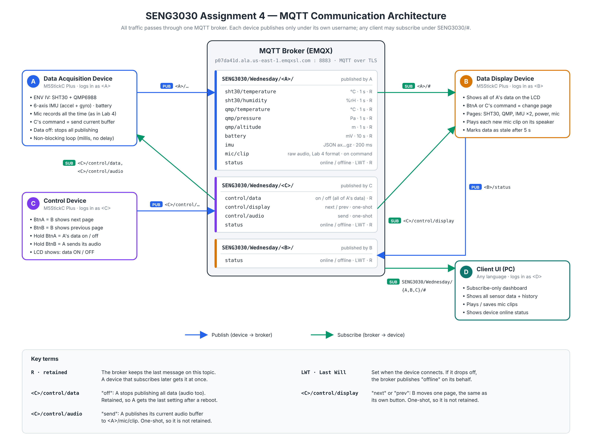

# SENG3030 Assignment 4 – Multi-device IoT prototype

Team: Alexia Tu, Carlos Gomez Guerrero, Deyi Zou, Juan Jose Bejarano

Three M5StickC Plus boards and a desktop UI talk through the course MQTT broker (EMQX, TLS on port 8883).

| Folder | Device | MQTT login |
|---|---|---|
| `A_DataAcquisition/` | A – reads all lab sensors, publishes them; sends a mic clip on C's command | `atu8211` |
| `B_DataDisplay/` | B – shows A's data on its LCD, pages with BtnA or C's next/prev, plays mic clips | `cgomezguerrero5580` |
| `C_Control/` | C – B next/prev page, A data on/off, ask A to send audio | `dzou1734` |
| `D_ClientUI/` | D – desktop dashboard (subscribe only) | any team account |
| `shared/` | `topics.h` (all usernames + topics), `ca_cert.h`, `secrets_example.h` | |
| `docs/` | Architecture diagram | |

## Setup (once per computer)

1. Clone this repo.
2. Copy `shared/secrets_example.h` to `shared/secrets.h` and fill in WiFi and the MQTT passwords
   (last 4 digits of each username). `secrets.h` is git-ignored – never commit it.
3. In VS Code use **File → Open Folder** on one device folder (e.g. `A_DataAcquisition`), then PlatformIO **Build** / **Upload**.
   Libraries download automatically on the first build.

## Rules

- Change topics **only** in `shared/topics.h`; all three boards include the same file.
- Do not use `delay()` (assignment requirement). Use `millis()` timers.
- Label the boards A / B / C so each gets the right firmware.

See `SUBMISSION_CHECKLIST.md` before zipping for submission.
